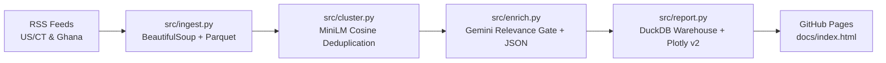

# Multi-Market Political Media & Narrative Intelligence Engine

An automated, serverless analytics pipeline that ingests political and policy news across **US National / Connecticut** and **Ghana**, clusters syndicated duplicates using local vector embeddings, filters non-policy wire noise via Gemini, and publishes an interactive v2 dashboard to **GitHub Pages**.

**Live Dashboard:** [https://s-akoto.github.io/media-narrative-intelligence/](https://s-akoto.github.io/media-narrative-intelligence/)

---

## Architecture



## Core Capabilities

1. **Multi-Market Ingestion (`src/ingest.py`)**
   * Collects recent articles from state investigative outlets (`CT Mirror`), national policy/legislative feeds (`NPR Politics`, `The Hill`, `PBS NewsHour`, `GovInfo`), and Ghanaian commercial/state media (`MyJoyOnline`, `Citi Newsroom`, `3News`, `Graphic Online`, `Daily Guide Network`).
   * Stores normalized records in columnar Parquet files (`data/raw_*.parquet`).

2. **Local Syndication Deduplication (`src/cluster.py`)**
   * Encodes article headlines and lead paragraphs locally using `sentence-transformers` (`all-MiniLM-L6-v2`).
   * Groups near-identical wire reprints via cosine similarity thresholds, retaining the longest article as the canonical record while tracking cross-outlet reach (`outlet_reach_count`).

3. **Structured Narrative Extraction & Relevance Gate (`src/enrich.py`)**
   * Uses a Pydantic-validated boolean gate (`is_relevant_policy_story`) to strip out foreign sports, celebrity gossip, and unrelated global wire reprints before reporting.
   * Extracts `policy_domain`, `agenda_initiator`, `framing_stance`, `key_entities`, `geographic_focus`, and `unanswered_questions` with built-in HTTP timeouts and automatic model fallback (`gemini-3.1-flash-lite` / `gemini`).

4. **DuckDB Analytics & Interactive v2 Dashboard (`src/report.py`)**
   * Materializes enriched Parquet datasets into `data/media_intel.duckdb` (`fact_media_stories`) using schema-resilient `union_by_name` queries.
   * Appends canonical stories into an incremental historical archive (`data/history_stories.parquet`) so weekly runs build longitudinal coverage over time.
   * Builds a standalone static dashboard (`docs/index.html`) featuring **Interactive Market Filter Tabs** (`All Markets`, `US & Connecticut`, `Ghana`), dynamic KPI summary cards, horizontal agenda-initiator and **Editorial Slant by Outlet-Type** charts, and a searchable, framing-filterable brief of accountability gaps with direct source links.
   * Automated weekly via `.github/workflows/weekly_pipeline.yml`.

## Local Setup

```bash
python3 -m venv .venv
source .venv/bin/activate
pip install -r requirements.txt

export GEMINI_API_KEY="your-api-key"

python src/ingest.py --config config/us_ct.yaml
python src/cluster.py --config config/us_ct.yaml
python src/enrich.py --config config/us_ct.yaml

python src/ingest.py --config config/ghana.yaml
python src/cluster.py --config config/ghana.yaml
python src/enrich.py --config config/ghana.yaml

rm -f data/history_stories.parquet
python src/report.py
```
